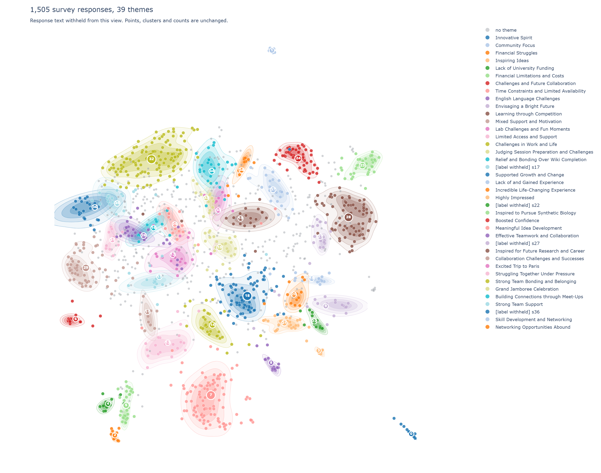

# broadlisten: the method code

This folder is the method code of the dashboard in the parent repository. The dashboard is in `../docs/`, the data in `../docs/data/`.

[](https://github.com/InteractionDataLab/broad-listening/actions/workflows/tests.yml)

broadlisten groups open-ended survey answers into named themes and tells you how
far each theme can be trusted.

You give it a CSV with a free-text column. You get back a theme for each answer
(or "unplaced"), a name and a grade for each theme, a sentiment for each answer,
and group comparisons with corrected p-values and intervals. Themes that fail a
check are flagged in the output, not removed.



*The study this package was built for: 1,505 answers from 332 participants in 125
teams, grouped into 39 sub-themes and 7 main themes. Grey points are answers the
clustering did not place. Four sub-theme names failed their checks and are shown
as "label withheld". The figure holds no answer text.
Interactive version: [`docs/demo_explorer.html`](docs/demo_explorer.html). All
figures: [`docs/index.html`](docs/index.html).*

## Quick start

```bash
pip install "git+https://github.com/InteractionDataLab/broad-listening#subdirectory=code"
```

Python 3.10 or newer. The base install is small (numpy, pandas, scikit-learn,
scipy). Optional parts: `embed` (torch and the embedding model), `reduce` (UMAP),
`cluster` (HDBSCAN), `language`, `keywords`, `viz`, or `all`.

A first try that needs no data, no GPU and no download:

```python
from broadlisten.cluster import hdbscan_cluster
from broadlisten.sample import sample_corpus, sample_embeddings

corpus = sample_corpus()                       # synthetic answers with planted themes
vectors = sample_embeddings(corpus.planted_theme.tolist())
labels, info = hdbscan_cluster(vectors, min_cluster_size=15)
print(info["n_clusters"], "themes;", info["n_noise"], "answers unplaced")
```

On your own data:

```bash
broadlisten preflight answers.csv --text-col answer --team-col school
broadlisten run       answers.csv --text-col answer --team-col school
```

`preflight` loads no model. It checks your column names (and suggests the nearest
one when a name is misspelt), describes the length of your answers, and counts
how many would be filtered as junk. Run it first. `--text-col` can be repeated to
pool several questions. All settings, with defaults, are in
[`docs/configuration.md`](docs/configuration.md). A real run needs a GPU and
downloads two open models. No answer text is sent to an online service.

## How it works

| Step | What it does | Tool |
|---|---|---|
| 1 Check | finds missing or misnamed columns before any GPU time | no model |
| 2 Clean | detects language, removes junk, keeps short answers | Lingua |
| 3 Embed | turns each answer into numbers, in its own language, no translation | Qwen3-Embedding-8B |
| 4 Map | reduces the numbers to a few dimensions and reports the distortion | UMAP, seeded |
| 5 Group | finds dense groups; answers in no group stay unplaced | HDBSCAN (or Ward) |
| 6 Name | proposes a name per group; may answer "insufficient evidence" | Qwen2.5-14B-Instruct |
| 7 Grade | decides what each theme may be used for | no model |

A step saves its result under a key made from its settings, so changing one
setting re-runs only the steps after it.

- Names: a name must be supported by quotes from the group, confirmed by a judge
  shown other members of the group, and sit closer to its own group than to any
  other. A name that fails is withheld.
- Grades: *claimable* (passed every check), *descriptive* (can be shown but not
  tested: unstable under resampling, or raised by too few people), *artifact* (the
  name failed its checks and is not printed).
- Sentiment: one of six levels, with the quoted words behind it; if the quote is
  not in the answer, the score is withheld.
- Group comparisons: Benjamini-Hochberg correction, Wilson intervals and Cliff's
  delta, with PERMANOVA for whole profiles and TOST for equivalence. A result of
  "no difference" is reported with the smallest difference the data could detect.

Scope: a few hundred to a few thousand short answers, in one or several
languages. Long transcripts must be split first, and a full run takes hours. The
package has been checked on one corpus of 1,505 answers in 125 groups.

## Data and privacy

- No real survey data is in this repository. The corpus in
  `broadlisten/sample.py` is generated from templates.
- The figures in `docs/` hold no answer text. Team-level figures are not
  published, because team names can identify people.
- A saved interactive map with hover text is your raw data in another form.
  `save_explorer` refuses to save one with answer text unless you pass
  `include_text=False` or `acknowledge_restricted=True`.
- If you find participant data in a file, tell the author directly. Do not open a
  public issue.

## What is in the repository

| Path | Contents |
|---|---|
| `broadlisten/` | the package |
| `examples/` | scripts 00 to 07, seven stage-by-stage notebooks, one Colab notebook |
| `analysis/` | the study's three notebooks, outputs cleared, data locations replaced by placeholders |
| `docs/` | the study's figures, built without answer text, and the settings reference |
| `tests/` | the test suite, run on Python 3.10, 3.11 and 3.12 |
| `requirements-study.txt` | the package versions the study ran on |

```bash
pip install -e ".[dev]"
python -m pytest tests/ -q
```

The tests also check that no notebook in `analysis/` carries outputs or a storage
id, and that no figure in `docs/` carries answer text. The statistics tests that
compare against the study's stored results skip unless
`BROADLISTEN_PUBLISHED_OUTPUTS` points to those files. The complete pipeline has
not been re-run end to end inside the test suite.

## Author, funding, citation, licence

Written by Md Nuruzzaman during a Master's research internship (M1 AIRE, Université
Paris Cité), for a study of open-ended answers from the iGEM 2025 survey, part of
the ANR project Open Futures (OPEN-FUTURES). Supervision: Marc Santolini and
Liubov Tupikina.

To cite the software, use "Cite this repository" (from `CITATION.cff`). For the
methods, cite their authors, named in the docstring of each function: Benjamini
and Hochberg (1995), Wilson (1927), Newcombe (1998), Hennig (2007), Anderson
(2001), Lakens (2017), Efron and Morris (1975), Monroe, Colaresi and Quinn
(2008), McInnes et al. (2018), Venna and Kaski (2001).

Apache-2.0 (`LICENSE`, `NOTICE`). The models are downloaded at run time and have
their own licences, listed in `NOTICE`.
